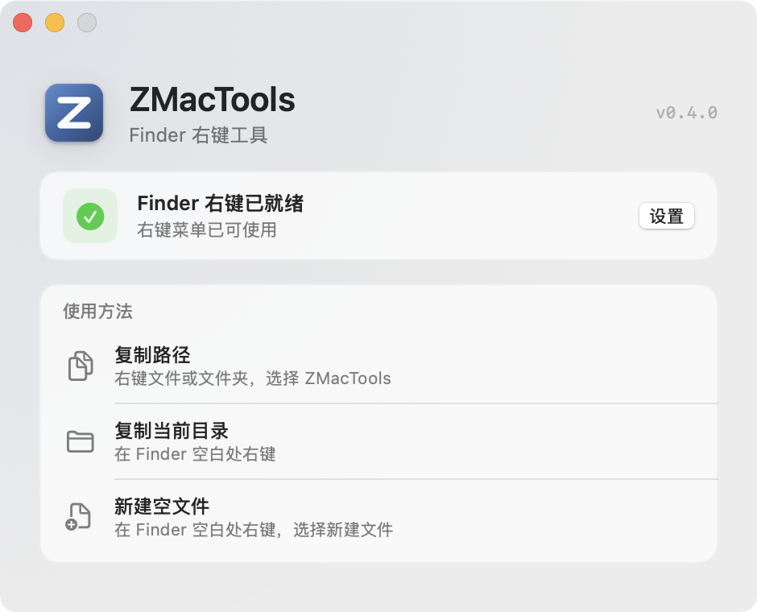

# ZMacTools

一款开源、本地运行的 macOS Finder 右键工具。当前提供复制绝对路径和新建空文件两个功能，代码结构为后续增加其他 Finder 动作预留了空间。



## 功能

在 Finder 中右键文件或文件夹，选择 `ZMacTools`：

- 复制文件或文件夹的绝对路径。
- 多选时按选择顺序复制，每个路径占一行。

在 Finder 空白处右键，选择 `ZMacTools`：

- 复制当前所在文件夹的绝对路径。
- 新建无后缀空文件 `新建文件`，并在 Finder 中选中它；按 Return 即可直接输入名称和后缀。
- 重复新建时自动使用 `新建文件 2`、`新建文件 3`，不会覆盖已有文件。

主窗口只显示 Finder 扩展状态和简短使用方法。关闭窗口后 App 会继续在菜单栏运行，右键功能不受影响。

## 环境要求

- macOS 14 或更高版本。
- Xcode Command Line Tools 或完整 Xcode。
- Rust stable，并安装当前 Mac 架构对应的 target：

Apple Silicon：

```bash
rustup target add aarch64-apple-darwin
```

Intel：

```bash
rustup target add x86_64-apple-darwin
```

## 安装

构建、安装并启动：

```bash
make install
```

脚本会运行 Rust 单元测试，编译 Rust 静态库、Finder 扩展和 Swift 宿主 App，然后做 ad-hoc 签名并安装到 `/Applications/ZMacTools.app`。

只构建、不安装：

```bash
make build
open build/ZMacTools.app
```

## 首次使用

1. 启动 ZMacTools。
2. 如果主窗口显示“Finder 扩展未启用”，点击“启用”，在系统设置的 Finder 扩展列表中打开 ZMacTools。
3. 打开 Finder，右键文件、文件夹或空白处，即可看到 `ZMacTools` 子菜单。

如果菜单没有立即出现，可以退出并重新打开 Finder。安装脚本会自动结束旧的 Finder 扩展进程，避免出现重复菜单。

## 实现说明

Finder 右键菜单必须由 Finder 通过 PlugInKit 加载的 App Extension 提供，因此扩展入口和菜单逻辑使用 Swift 与 FinderSync 框架实现。

Rust 负责可以独立测试的核心逻辑：把 Finder 提供的 `file://` URL 转成规范化绝对路径，包括百分号解码、Unicode、根目录和异常输入处理，并通过 C ABI 静态链接进 Finder 扩展。宿主 App 负责扩展状态展示和新建文件请求。

Finder 会在显示菜单时丢弃 `NSMenuItem.representedObject` 中保存的自定义对象，因此复制动作需要的目标 URL 暂存在 Finder Sync 扩展实例中，等菜单动作回调时再读取。

### 架构

```text
┌─────────────────────────────────────┐
│ AppKit 容器 + SwiftUI 主界面         │
│ 扩展状态、使用方法、新建文件请求     │
└───────────────┬─────────────────────┘
                │ zmactools://
┌───────────────▼─────────────────────┐
│ Finder Sync 扩展 (.appex)            │
│ 右键目标识别、菜单、剪贴板、新建请求 │
└───────────────┬─────────────────────┘
                │ C ABI / 静态链接
┌───────────────▼─────────────────────┐
│ Rust 核心库                          │
│ 路径转换与边界情况处理               │
└─────────────────────────────────────┘
```

## 开发

常用命令：

```bash
make test     # Rust 单元测试
make build    # 构建 App 和 Finder 扩展
make install  # 构建并安装到 /Applications
make icon     # 从 assets/icon.svg 重新生成 .icns
make clean    # 清理 build 和 target
```

目录结构：

```text
app/                       AppKit/SwiftUI 宿主 App
  Sources/
    ContentView.swift
    NewFileController.swift
    ZMacToolsApp.swift
  Info.plist
extension/                 Finder Sync 扩展
  Sources/
  Info.plist
  Finder.entitlements
crates/zmt-core/           Rust 核心库与 C 头文件
scripts/                   构建、签名、安装、图标脚本
docs/                      README 使用的界面截图
```

## 已验证范围

- macOS 15.3 / Apple Silicon / Xcode 16 / Swift 6 环境编译通过，ad-hoc 签名校验通过。
- Rust 核心 10 个单元测试通过。
- 通过真实 Finder 右键菜单验证：空白处复制当前目录路径、右键单个文件夹复制路径、多选两个项目复制两行路径。
- 通过真实 Finder 空白处右键菜单和 `zmactools://` 冷启动请求验证新建文件，包括临时目录和 `~/Desktop`。
- Finder 扩展由 PlugInKit 注册并被 Finder 加载，主窗口和菜单栏入口已在真实桌面环境检查。

尚未验证：

- Developer ID 签名、公证分发和 Intel Mac 运行。
- 在干净 Mac 上通过网络下载后的首次安装和覆盖更新。

## 本机使用与分发

当前构建使用 ad-hoc 签名，适合在本机使用。重新构建后 Finder 扩展通常仍保持启用；如果系统因签名变化重新登记扩展，可能需要在系统设置中再确认一次。

如果需要公开分发给其他用户，才需要 Apple Developer Program 的 Developer ID Application 证书。宿主 App 和 Finder 扩展必须使用同一签名身份，并对最终 App 做公证和 stapler 装订。仅在本机使用时不需要申请 Developer ID，也不需要使用固定的 Bundle ID。

## 隐私

所有处理都在本地完成。复制动作只写入系统剪贴板，新建文件只写入用户选择的目标目录；没有网络请求、遥测、账户或文件上传。

## License

[MIT](LICENSE)
